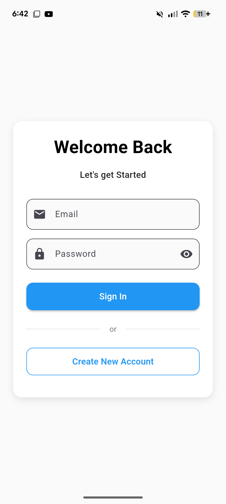
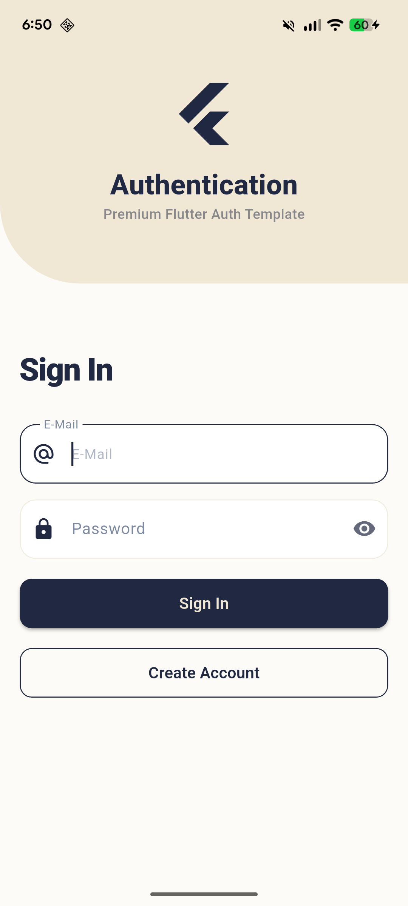
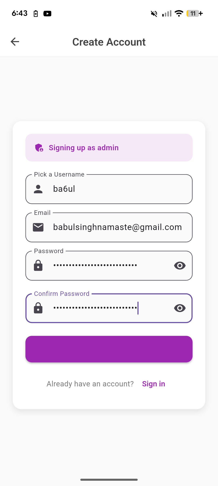
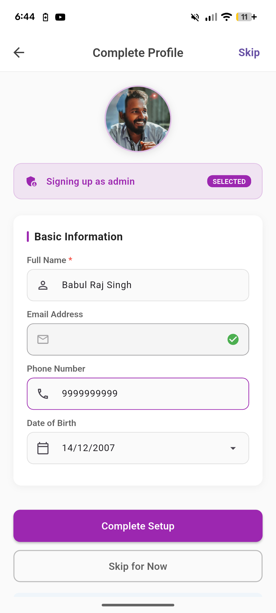

# multi-role-flutter-auth


# 📸 Mobile Screenshots
<table> <tr> <td> 
   </td> <td> 
   </td> <td>
   </td> <td>
   </td> <td>
   </td> </tr>
</table>

# 📦 Database Setup (Supabase)

This project needs a Supabase table named `user_profiles`. Full walkthrough (with screenshots) is in [SUPABASE_SETUP.md](SUPABASE_SETUP.md).

### Steps
1. Open **Supabase Dashboard**
2. Go to **SQL Editor**
3. Copy–paste the content of [`schema.sql`](schema.sql)
4. Click **Run**

---

## 🚀 Dual-Mode Authentication Flows

This library supports two distinct authentication architectures out of the box, controlled via a simple configuration.

### 1. Enterprise Mode (Multi-Role)
* **Best for:** Admin panels, Organization apps, SaaS platforms.
* **The Flow:** User explicitly selects a role (e.g., *Admin, Director, Writer*) → System generates a standardized ID (e.g., `ADM-4521`).
* **UI Experience:** Includes a "Pick your Role" screen during sign-up.

### 2. Consumer Mode (Single-Role)
* **Best for:** Social apps, Games, E-commerce, Standard User apps.
* **The Flow:** User picks a unique Username → System assigns a default hidden role (e.g., `DEF`) → System generates a unique ID (e.g., `DEF-alian22`).
* **UI Experience:** Skips the Role Picker. The role assignment happens invisibly in the background for a seamless sign-up experience.

> **💡 Future-Proof:** Even in Single-Role mode, the backend maintains a role-based structure. This means you can scale a simple social app into a multi-role ecosystem (adding Moderators, VIPs, etc.) later without rewriting your database or migrating data.

## 🧩 What this project actually is

This is a complete, working multi-role auth app - and also the demo of what the final installation of [flutter_auth_kit](https://github.com/ba6ul/flutter_auth_kit), the UI kit, and the other kits looks like once they're actually put together in a real project, not just described in isolation.

Everything here is fully functional and verified end to end against a real Supabase backend. For the actual packages/bricks, more advanced usage, and to leave feedback or file issues, check those repos directly rather than this one:

- **[flutter_auth_kit](https://github.com/ba6ul/flutter_auth_kit)** - the auth logic (bloc, roles, repository, Supabase calls). A real dependency, wired in here as a git submodule at `packages/flutter_auth_kit`. Deliberately has no UI.
- **[haripin_bricks](https://github.com/ba6ul/haripin_bricks)** - [Mason](https://github.com/felangel/mason) bricks that scaffold the reusable, non-auth-specific foundation. Not a dependency - each one generates plain files into the project once, and from then on they're just app code you edit freely:
  - `haripin_core` → colors, sizes, text strings, validators, helpers, API-key config
  - `haripin_uikit` → theme + widget themes, loading spinner
  - `auth_ui` → login/signup/profile-setup screens, the auth gate, dashboard router - the UI layer that sits on top of `flutter_auth_kit`

Starting a new app with the same foundation: `mason make haripin_core`, `mason make haripin_uikit`, `mason make auth_ui`, then add `flutter_auth_kit` as a dependency.

### Cloning this repo

`flutter_auth_kit` is a git submodule, so a plain `git clone` leaves `packages/flutter_auth_kit/` empty:

```sh
git clone --recurse-submodules https://github.com/ba6ul/multi-role-flutter-auth.git
# or, after a normal clone:
git submodule update --init
```

---

    UI: Skips the Role Picker. Seamless sign-up experience.
